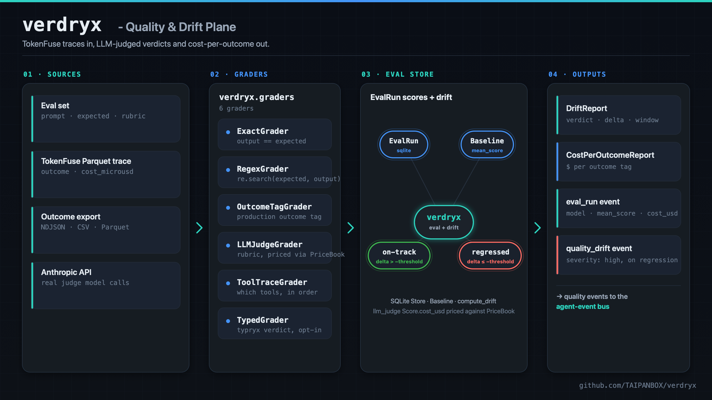
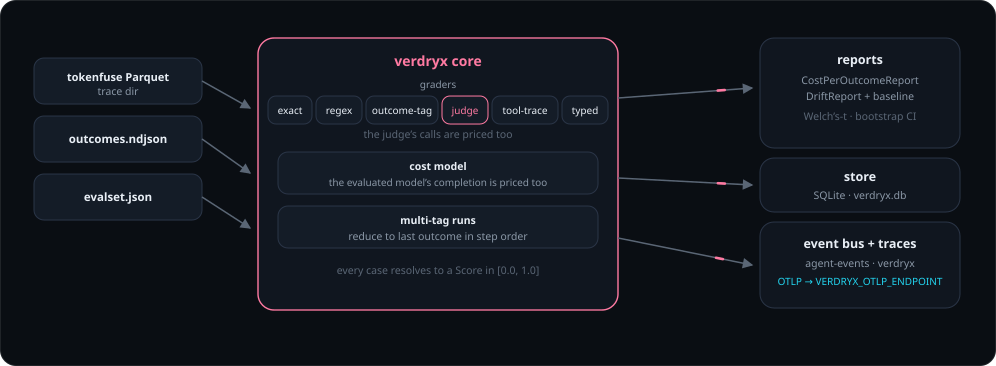
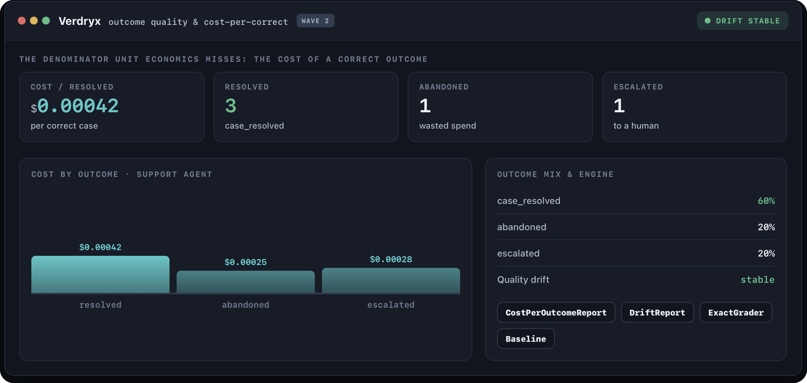
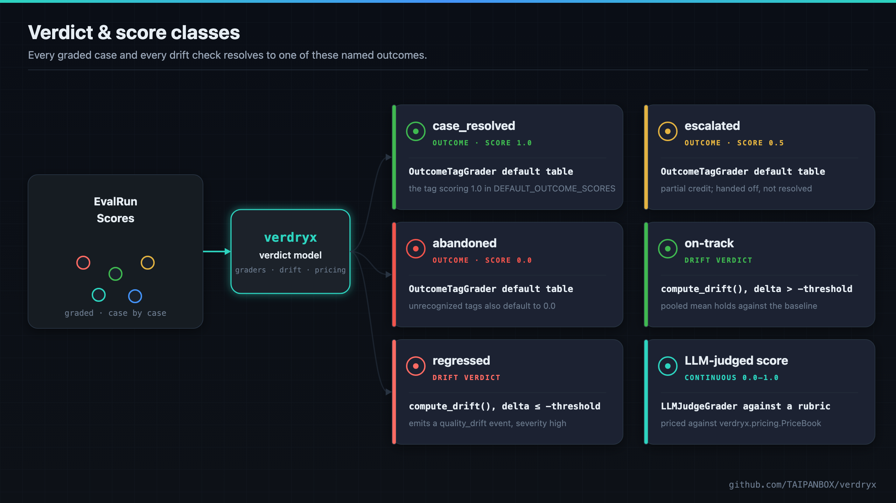
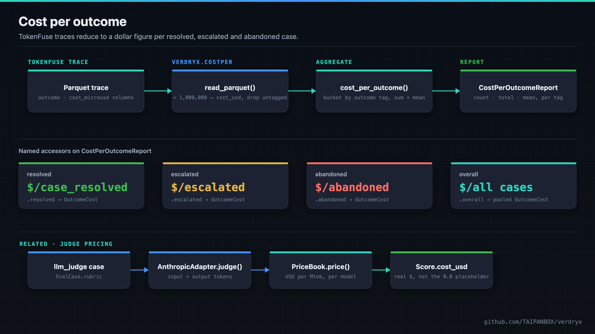

<div align="center">

# verdryx - Quality & Drift Plane

**Grade an agent's outputs against an eval set or a production outcome tag, then catch when quality drifts.**

[](https://github.com/TAIPANBOX/verdryx/actions/workflows/ci.yml)


-success.svg)



</div>

Line coverage of the `verdryx` package: **98%** (`2164/2211` statements).
`@measured pytest --cov=verdryx --cov-report=term-missing 2026-11-04` (python 3.11 on forge, as CI).
Unlike the tests badge above, this figure is not gated (see CLAUDE.md invariant
11): recomputing it inside a gate would mean running the full suite inside a
gate, which is what the other gates already run once per CI job, so it is
restated by hand at the point it is measured instead.

**Verdryx measures whether an operator's own agents did their job correctly.
It never manipulates outputs, never crafts adversarial prompts, and never
attacks anything.** Given an eval set, it grades a model's outputs against
expected values, regex patterns, recorded production outcome tags, or an
LLM-judged rubric, stores the results, and tells you when quality has
drifted against a baseline you set. A companion tool turns TokenFuse's
outcome-tagged Parquet traces into a real dollar figure per resolved,
escalated and abandoned case. This is entirely defensive, self-measurement
tooling for the operator running the agents, not a red-teaming or
offensive-security tool.

<div align="center">



<sub>The same service as its room on <a href="https://it-rat.com/services/verdryx.html">it-rat.com</a> draws it, where the diagram sits next to a simulation you can scrub back and forth.</sub>

</div>

---

## Where this fits in the stack

Verdryx is the quality plane of the TAIPANBOX agent-governance stack: it grades an agent's outputs and tells you when quality has drifted against a baseline.

```mermaid
flowchart TB
  Agent["AI agent (any framework)"] -->|"LLM call (base-URL swap)"| TF["TokenFuse proxy: spend + enforcement"]
  TF -->|"POST /v1/decide (PEP)"| WX["Wardryx: policy PDP"]
  WX -.->|"allow / deny / hold"| TF
  TF -->|"cheapest model, budget OK"| LLM[("LLM provider")]
  TF -->|"CallRecords"| CL["TokenFuse Cloud: control plane, incidents, replay, evidence, kill-switch"]
  VCX["Vouchryx: delegation proved, and endable"] -->|"short-lived token: act + cnf"| TF
  TF -.->|"polls /v1/revocations"| VCX
  VCX ==>|"delegation_issued / denied / revoked"| BUS
  TF ==>|"agent-event NDJSON"| BUS{{"agent-event bus + Agent Passport"}}
  WX ==> BUS
  Agent -->|"web fetch: MCP tools/call"| BRK["TokenFuse MCP broker: the scopyx key from its vault, the run labelled from the act"]
  BRK -->|"last hop"| SCX["Scopyx: governed web egress"]
  BRK -->|"observed act"| TF
  Agent -.->|"or direct, key in a header"| SCX
  SCX -->|"POST /v1/decide"| WX
  SCX ==>|"web_fetch / web_blocked"| BUS
  ENG["Engram: memory"] -->|"reflect via base_url"| TF
  ENG ==> BUS
  BUS ==> IDX["Idryx: identity graph, detectors, Agent-BOM"]
  IDX ==>|"identity_finding"| BUS
  BUS ==> QX["Qryx: crypto / PQC, passport + hash-chain scan"]
  QX ==>|"crypto events"| BUS
  BUS ==> VX["Verdryx: quality / drift"]
  VX ==>|"quality events"| BUS
  VX ==>|"slo_burn: a policy can hold the agent"| WX
  TF -->|"outcome-tagged traces"| VX
  MX["Mockryx: pre-prod safety rehearsal"] -->|"hostile scenarios"| TF
  MX ==>|"sim events"| BUS
  BILL[("cloud, SaaS and model bills")] --> CC["CostCrew: the bill, worked by a crew of agents"]
  CC ==>|"spend_spike / budget_threshold / crew moves"| BUS
  BUS ==> TRX["Trailryx: the record plane, sealed and packed"]
  BUS ==> HX["reads the log, mails you (heraldyx)"]
  HX -->|"one mail, a view and never an action"| OPS["your mailbox"]
  HX ==>|"alert_sent"| HJ[("heraldyx's own hash-chained journal, not this bus")]
  YOU(["you, in a browser over your own tunnel"]) --> GX[["Genaryx: the console over all of it"]]
  GX -->|"commands: the kill, an approval, a policy"| CL
  GX -->|"signed commands"| WX
  GX ==>|"console_command"| BUS
  GX -.->|"reads it"| IDX
  GX -.->|"reads it"| QX
  GX -.->|"reads it"| VX
  GX -.->|"reads it"| MX
  GX -.->|"reads it"| ENG
  GX -.->|"reads it"| SCX
  GX -.->|"reads it"| CC
  TFP["terraform-provider-taipan"] -->|"budgets + passports as code"| CL
  ASG[["agent-stack-go: shared Go contract"]] -.->|imported by| IDX
  ASG -.->|imported by| WX
  ASG -.->|imported by| MX
  ASG -.->|imported by| TFP
  ASG -.->|imported by| HX
  ASG -.->|imported by| QX
  SPEC[["agent-passport: the spec"]] -.->|governs| BUS
```



- **Consumes**: outcome-tagged traces and records exported by **TokenFuse** (via `tokenfuse outcomes --json` or Parquet traces).
- **Produces**: cost-per-correct metrics, quality scores, drift reports, and `source: verdryx` events.
- **Talks to**: **TokenFuse** (its LLM judge can route through TokenFuse via `base_url`, and TokenFuse is the source of the traces Verdryx scores); **Wardryx** reads the `slo_burn` events in this plane's event file when `WARDRYX_SIGNAL_EVENTS` names it (Wardryx 2.5.0), and a policy of Wardryx's own can hold the agent's calls for a person while its error budget is spent.

The full stack is TokenFuse (spend), Wardryx (policy), Vouchryx (delegation), Engram (memory), Idryx (access), Qryx (crypto), Verdryx (quality), Mockryx (pre-prod), scopyx (governed web egress), CostCrew (the bill), Trailryx (the record) and heraldyx (the mail out), on the shared Agent Passport + agent-event contract (agent-stack-go / agent-passport), configured via terraform-provider-taipan and driven from Genaryx, the console over all of it.

Run the whole open stack locally with one command via [**stack-up**](https://github.com/TAIPANBOX/stack-up); the stack's home on the web is [**it-rat.com**](https://it-rat.com).

## Live infrastructure validation

Before any public launch, Verdryx computed cost-per-outcome from real Parquet traces produced by a live,
Claude-backed multi-agent run: a correctly resolved case cost $0.00042, while an abandoned attempt still
cost $0.00025 for nothing - the gap a dollar total alone can't show.



Full write-up and all numbers: [`VALIDATION.md`](VALIDATION.md).


### Running it on a Kubernetes cluster

The whole stack was deployed as a five-node k3s cluster on Hetzner, AWS and GCP
between 25 and 27 July 2026 (six clusters, all destroyed afterwards). The
manifests, the traps and the evidence are public in
[stack-k8s](https://github.com/TAIPANBOX/stack-k8s). Verdryx is not a pod. The console **executes** it to read and run
evaluations against `verdryx.db`, so the binary lives inside the console image
rather than beside it, and the store takes an ordinary ReadWriteOnce volume.
The practical consequence: there is no service to scale and no endpoint to
guard, which is the correct shape for something that runs on a schedule rather
than in a request path.

To be clear about scope: those runs verified the deployment shape and the
service coming up correctly on three clouds. They did not produce quality numbers: the quality plane was
deliberately left unseeded on those clusters, so nothing about grading or
drift was measured there and nothing is claimed.

---

## What it does

Verdryx is a pipeline: **eval set / traces → graders → eval store → drift +
cost-per-outcome + events** (the diagram at the top). Every grader produces
the same `Score` shape, so the eval runner dispatches to whichever a case
asks for without special-casing.

| Stage | What it covers |
|---|---|
| **Eval runner** | `verdryx.cli.run_eval` / `verdryx eval`: loads an `EvalSet` (a list of `EvalCase` prompts), calls a model for each case, grades the output, and stores the result as an `EvalRun` of per-case `Score`s in a local SQLite file |
| **Six graders** | `verdryx/graders.py`: exact match, regex match, a `tokenfuse x-fuse-outcome` tag lookup, an LLM-judged rubric, tool-call accuracy (which tools, in what order), and a typed verdict from typryx (an optional, separate service), opt-in via `--typed-url` |
| **Baselines and drift** | `verdryx/drift.py`: snapshot an `EvalRun`'s mean score as a `Baseline`, then compare a window of later runs against it |
| **Cost per outcome** | `verdryx/costper.py`: given a flat export of `{outcome, cost_usd}` records, computes cost-per-resolved-case, cost-per-escalated, cost-per-abandoned, and overall |
| **Findings and fixes** | `verdryx/findings.py`: a drift regression or an established error-budget breach becomes a finding (agent, window, kind, evidence, suspect), a registered fix is verified or failed by the runs after it, `verdryx findings list/show/fix`; no model, no new event type |
| **Human grades** | `verdryx grade`, `verdryx principal`: a reviewer's grade outweighs the model's in the mean, drift and the quality floor, carries its author, and is written through one door an uploader cannot use |
| **Opt-in event log** | `verdryx/events.py`: an NDJSON writer for the shared TAIPANBOX Agent Passport event envelope (schema `taipanbox.dev/agent-event/v0.2`, `source: "verdryx"`), so `eval_run`, `quality_score`, and `quality_drift` events reach the rest of the governance stack |
| **Opt-in OTLP export** | `verdryx/otel.py`: a hand-rolled OTLP/HTTP-JSON span per `eval`/`drift` run to `VERDRYX_OTLP_ENDPOINT`, so a trace collector (Grafana/Datadog/Honeycomb) sees eval/drift activity regardless of verdict |

---

## Graders and verdict classes

<div align="center">

</div>

Every case resolves to a `Score` in `[0.0, 1.0]`; every drift check resolves
to one of two named verdicts. Five graders share one shape (`grade()` on an
`EvalCase`), so `verdryx eval` dispatches to whichever a case asks for; a
sixth, `ToolTraceGrader`, is dispatched differently since it scores a tool
trace rather than free text (see
[Tool-call accuracy](#tool-call-accuracy-tool_trace) below):

| Grader | `case.expected` / `case.rubric` | Scores 1.0 when |
|---|---|---|
| `ExactGrader` | `expected`: literal string | `output == expected` |
| `RegexGrader` | `expected`: a regex pattern | `re.search(expected, output)` matches |
| `OutcomeTagGrader` | none (reads `output` itself) | `output` is a tag mapped to `1.0` in its table |
| `LLMJudgeGrader` | `rubric`: grading instructions | the injected judge scores the rubric that high |
| `TypedGrader` | `expected`: an optional human label, see below | a typryx `noul` template answers `true` with probability 1.0 |
| `ToolTraceGrader` | `tools` / `expected_tools`: see below | the model's ordered tool calls exactly match `expected_tools` |

`OutcomeTagGrader`'s default table is `{"case_resolved": 1.0, "escalated":
0.5, "abandoned": 0.0}` (`verdryx.DEFAULT_OUTCOME_SCORES`), fully overridable
via its `mapping` constructor argument. An unrecognized tag scores `0.0` by
default rather than raising.

`LLMJudgeGrader` takes an injected adapter satisfying the `LLMAdapter`
protocol (`complete()`, `judge()` and `complete_with_tools()`). Two are provided:

- `StubLLMAdapter`: deterministic, records every call, no network. This is
  what Verdryx's own tests use, and what `--model stub` selects on the CLI.
- `AnthropicAdapter`: the real adapter, backed by the Anthropic Messages
  API. Its constructor mirrors the `AnthropicAdapter` seam in
  [Engram](https://github.com/TAIPANBOX/engram) (`engram/llm.py`): `model`,
  `base_url`, and `api_key` are accepted the same way, and `base_url` lets
  judge/completion calls route through a proxy (e.g. TokenFuse) instead of
  hitting Anthropic directly. Its `judge()` calls also price themselves
  against `verdryx.pricing.PriceBook` (a Python port of TokenFuse's own
  default price book), so an `llm_judge` case's `Score.cost_usd` is a real
  dollar figure, not the `0.0` placeholder the exact, regex, outcome-tag and
  tool-trace graders leave in place (they make no model call, so there is
  nothing to price).

The candidate output a judge grades is wrapped in an `<output-...>` block with an
instruction to treat it as inert data, the same delimited-block technique
Engram uses for episodic content. The closing tag carries a random token drawn
fresh for every call, so the output cannot close its own block and write to the
judge from outside it; a fixed `</output>` could be closed by the output itself.
Grading untrusted agent output is exactly the kind of place a prompt injection
would try to hijack the grader, so the judge prompt is built defensively even
though Verdryx itself never acts on what it reads.

**Drift** (`compute_drift(recent_runs, baseline, threshold=0.05)`) pools
every case score across a window of the most recent eval runs into one mean
(not a mean of each run's own mean, which would distort unevenly-sized
runs), then compares that pooled mean to `baseline.mean_score`:

- `delta = mean_score - baseline.mean_score`
- `verdict = "regressed"` if `delta <= -threshold`, else `"on-track"`

That flat threshold is always sufficient on its own to trip the verdict, and
never goes away. When the caller also passes `baseline_run` (the baseline's
original `EvalRun`, with its per-case scores), `compute_drift` additionally
runs a two-sample significance check between those scores and the recent
pooled ones: a Welch's t-statistic (informational) plus a bootstrap
confidence interval on the delta. If that interval's upper bound stays below
zero, the verdict is `"regressed"` too, even when the drop is smaller than
`threshold` -- catching a small but consistent regression a flat threshold
sized to filter noise would otherwise miss.

`verdryx drift --baseline ID --window N` fetches the baseline, filters
stored runs to the same model, takes the `N` most recent, and prints the
report -- including the t-statistic and confidence interval whenever the
baseline run has at least two scores to compare against (it already loads
that run to filter by model, so this is free). On `regressed`, and only
then, it emits a `quality_drift` event (severity `high`) if an event log is
configured, under `--agent-id` if one is given and otherwise under the agent
the newest compared run was evaluated as (`verdryx eval --agent-id` stores it
with the run), and its `run_id` is that newest run's; `on-track` checks are not reported as events.

---

## A typed verdict from typryx

[typryx](https://github.com/TAIPANBOX/typryx) is a separate, optional
service that answers a typed question (a choice, a score, or a yes/no,
called `noul` there) with a probability instead of a sentence. `TypedGrader`
asks it about a case's output instead of asking a priced judge to write a
number in prose; unlike `LLMJudgeGrader`, this makes no direct outbound
model call itself, only an HTTP request to typryx (stdlib `urllib`, no new
dependency), and typryx's own backend is what may or may not be priced.

Opt-in and nothing else:

```sh
verdryx eval typed-cases.json --model stub --db verdryx.db \
    --typed-url http://127.0.0.1:4320 --typed-key-file /path/to/typryx.key
```

- `--typed-url URL` is the ONLY thing that enables `GraderKind.TYPED` cases.
  No environment variable turns it on by itself: typryx may run a paid
  backend, and CLAUDE.md invariant 5's own rule (a grader that costs money
  never runs by default) applies here too, held the same way, by
  `scripts/no-paid-by-default.sh`.
- `--typed-key-file PATH` (or `$VERDRYX_TYPRYX_KEY_FILE`) names a file
  holding the credential sent as `X-Typryx-Key`; the key is never accepted
  on the command line, which would show up in `ps`.
- `--typed-template ID` picks which typryx template to ask (default:
  `eval.outcome_met`).
- `--typed-timeout SECONDS` is how long verdryx waits for each typryx answer
  (default 30). A model that is slow to load or slow to read a prompt (a local
  CPU model on a busy machine: 23 s for a cold first answer, 5 to 13 s after
  it, measured 2026-11-04 on `qwen2.5:7b`) needs more, and typryx's own
  `TYPRYX_TIMEOUT_MS` should stay below it. Order matters: typryx giving up
  first comes back as an unanswered case, counted and not scored; verdryx giving
  up first ends the run, saves nothing and leaves typryx recording the ask as
  `canceled`. The error says `did not answer within Ns` for a wait that ran
  out and `could not reach` only for a connection that never happened.

A typed case sends `{"task": case.prompt, "final_answer": output}` as its state
to typryx, with the template id beside it and, while an eval run is in progress,
the run's own id as `run_id`. No rubric and no case id. The verdict becomes the
`Score`: a `noul` template's `probabilities["true"]` directly, a `score`
template's probability-weighted mean level normalised to `[0, 1]`; a
`choice` template has no order and is refused rather than scored. When
typryx answers `unanswered` (a timeout, a backend error, a model that
returned no probabilities), that is never turned into a `0.0`, because
CLAUDE.md invariant 8 says an unmeasured indicator is never a zero.
`@decided 2026-09-25` (paraphrase): the case is counted apart instead, with
typryx's own `answer_id` and reason, scores nothing, and the run completes
and is saved with its mean taken over the answered cases only -- `verdryx
eval`'s own printout shows `unanswered: N of M asked (reason: count, ...)`
beside the mean, and `EvalRun.unanswered` carries the same rows in the
store. A run where every case comes back unanswered has no mean at all:
the printout reads `mean score: unmeasured (0 of M answered)` rather than
`0.000`, and `verdryx baseline` refuses to snapshot it (a baseline of an
unmeasured mean would be a fabricated number).

This replaced an earlier behaviour, kept here because the reason is worth
knowing: before 2026-09-25, one unanswered case failed the WHOLE run, and
any outcomes already posted to typryx for earlier cases in that run stayed
in its ledger while the run itself was thrown away (verdryx#42). Measured
against a real backend on 2026-09-25 (a local Ollama `qwen2.5:7b`), 3 of 60
asks came back unanswered in that run, so a 60-case run at that rate could
never complete under the old behaviour.

A refusal (its hourly cap, a bad key, an unknown template) or a typryx
nobody could reach is a different fact from an unanswered verdict -- an
infrastructure failure, not a verdict -- and it still fails the run the
same way it always did, naming the HTTP status and typryx's code, never
the key, with nothing saved.

When a typed case's `expected` is set (a human label: `"true"`/`"false"` for
a `noul` template, a decimal integer string for a `score` template), grading
it also posts that label back to typryx as the outcome for the exact answer
it was given, `source: "verdryx:evalset"`, so `typryx calibration` can score
it later. No flag gates this half; posting an outcome is unpriced, and a
label that does not fit the question's type is refused before anything is
posted, never guessed.

---

## Tool-call accuracy (tool_trace)

A sixth grader, `ToolTraceGrader`, scores WHICH tools a model chose and IN
WHAT ORDER, straight from the model's own `tool_use` content blocks. Verdryx
already calls the model under evaluation for every non-`outcome_tag` case
(via `LLMAdapter`); a `tool_trace` case sends the same prompt with a `tools`
array attached and grades what the model chose to call, in the order it
chose to call them.

```json
{
  "id": "support-tier1-tools-v1",
  "cases": [
    {
      "id": "refund-flow-tools",
      "prompt": "The customer's order #4471 arrived damaged. Handle it.",
      "grader": "tool_trace",
      "tools": [
        {
          "name": "lookup_order",
          "description": "Look up an order by id",
          "input_schema": {
            "type": "object",
            "properties": { "order_id": { "type": "string" } },
            "required": ["order_id"]
          }
        },
        {
          "name": "issue_refund",
          "description": "Issue a refund for an order",
          "input_schema": {
            "type": "object",
            "properties": { "order_id": { "type": "string" } },
            "required": ["order_id"]
          }
        }
      ],
      "expected_tools": ["lookup_order", "issue_refund"]
    }
  ]
}
```

`tools` is a small array of provider-shape tool definitions (the Anthropic
Messages API's own `tools` shape), passed to the adapter verbatim -- Verdryx
does not reinterpret or validate the schema inside it. `expected_tools` is
the ordered list of tool NAMES a correct response should call; an empty
list (`"expected_tools": []`) is legal and means the model is expected to
call no tools at all for that case.

### How scoring works

`ToolTraceGrader.grade_trace()` compares the model's own ordered tool names
against `expected_tools`:

- **Exact ordered match** -- including both lists being empty, meaning the
  model correctly called no tools -- scores `1.0`.
- **Otherwise**, the score is the length of the longest common subsequence
  (LCS) between the two ordered lists, divided by the longer list's length,
  a value in `[0, 1)`. A swapped order, an extra call, or a missing call
  each cost credit smoothly instead of the case scoring `0.0` outright; a
  completely disjoint trace still lands at `0.0`.

### Single-turn, no execution, by design

Verdryx grades the model's **first response's** tool selection and order,
nothing more. It never executes a tool, never sends a `tool_result` back,
and never continues the conversation to a second turn. Verdryx does not
call tools itself and does not become an agent runtime -- it is, and will
stay, a grader that reads what the model chose to call.

### Why this grader runs live, not from stored traces

Every other Verdryx grader can, in principle, be pointed at data someone
already recorded. `tool_trace` cannot: TokenFuse's own Parquet traces record
only a tool-call **count** per call (see `tokenfuse`'s `docs/21` trace
schema), never the tool **names** or their **order** -- there is nothing in
a stored trace for this grader to read. Scoring tool selection and order
therefore requires calling the model under evaluation directly, via
`LLMAdapter.complete_with_tools()`, once per case, rather than reading it
back out of TokenFuse afterward.

### Drift and baselines work on this unchanged

`ToolTraceGrader.grade_trace()` returns a plain `GradeResult`, folded into
the same `Score` shape by `verdryx.cli.run_eval` as every other grader.
`compute_drift` and `verdryx baseline`/`verdryx drift` never look at grader
kind, only at `Score.value`, so a baseline set from a `tool_trace` run and a
later drift check against it work with no extra plumbing at all. In
practice this means tool-selection drift -- a model quietly starts skipping
a step, or reordering two calls -- shows up in `verdryx drift` the same way
any other quality regression does: tool-selection drift detection for free.

---

## Error budgets

`verdryx slo` turns quality into an allowance an operator can be out of: four
indicators, each a ratio of good runs over eligible runs, with the error
budget left on each and the rate it is going.

```sh
verdryx slo --traces "$TOKENFUSE_DATA_DIR"
```

Three of the four are computed from the trace alone. The fourth,
`quality_floor`, needs a score per run, and a TokenFuse trace records what a
call cost and how it was decided, never how good the answer was. Those scores
are in Verdryx's own eval store, and the two share no run identity: a
TokenFuse `run_id` belongs to a piece of gateway traffic, an eval run id to a
batch of cases that never went through a gateway. The join is the agent, and
nothing else:

```sh
verdryx eval cases.json --model stub --db quality.db \
    --agent-id agent://acme.example/support/bot
verdryx slo --traces "$TOKENFUSE_DATA_DIR" --scores-db quality.db
```

A run evaluated with no `--agent-id` belongs to nobody. Its scores are counted
and put in no subject's numbers, the same rule the report already applies to a
trace run carrying no identity, because a fleet must not score better for
being less identified.

It measures. It does not enforce: no policy is written, no agent is demoted,
and there is no autonomy tier in this stack to demote one into. The reasons
that is the honest shape rather than an unfinished one are in invariant 9 of
CLAUDE.md. What a deployment adds on top is Wardryx's: it can read the
`slo_burn` events this writes (`WARDRYX_SIGNAL_EVENTS`, off unless set) and a
policy of its own that reads the signal can hold the agent's calls for a person
while the budget is spent. That decision is Wardryx's, under its own
policy; this plane still writes no policy and holds nothing.

**The window is real.** `--window` (default `28d`, a whole number of hours,
days or weeks) leaves out every run and score that ended before it, and the
report says how many, so a bad spell stops counting once the window has passed
it. A run that carries no time stays in and is counted, because nothing says it
is old. A window that cannot be read is refused.

**A hold need not spend the budget that caused it.** To `containment` a held
call is a refusal, which is right for a report and wrong for a deployment where
these events put the agent on hold: each held call would spend more of the
budget, and an agent still working could never earn it back. Run the command
with `--holds-spend-no-budget` there. A run only a hold stopped then meets
containment, and every other refusal still counts. The trace records that a call
was held, not which rule held it, so the switch sets every hold apart.

Three things it will not do, each on purpose. It sends no event unless the
confidence interval's upper bound sits below the objective, so a shortfall
that could be a small sample is reported and not paged. It never alerts on a
slow burn, because severity is fixed per event type and a budget that will be
gone by Friday does not belong in the band for one already gone. And it prints
what it could not measure beside what it could, so four calm indicators cannot
quietly mean four unmeasured ones.

The design, the arguments behind each default, and the bug we shipped for an
afternoon are written up in [docs/agent-slos.md](docs/agent-slos.md).

## Findings, fixes and human grades

`drift` and `slo` used to print a verdict and forget it. A failure they see is
now written down as a **finding**, a fix can be registered against it, and a
person can grade a case in a way the model's score cannot overrule. None of it
calls a model, and none of it adds an event to the bus: findings are tables in
the same SQLite store the console already reads.

### A failure becomes a finding

```sh
verdryx drift --baseline "$BASELINE" --db quality.db
verdryx slo --traces "$TOKENFUSE_DATA_DIR" --scores-db quality.db --db quality.db
verdryx findings list --db quality.db
verdryx findings show 3f2a9c1d --db quality.db
```

A finding names the **agent**, the **window** it was seen over, the **kind** of
failure (`drift`, `slo_exhausted` or `slo_fast_burn`, with the indicator for the
last two), the **evidence** (run ids: `eval:<run>` for a stored run,
`eval:<run>:<case>` for the lowest scoring cases, `trace:<run_id>` for the
gateway runs that failed an indicator), the numbers (delta and interval for
drift, observed ratio, interval, budget and burn for an indicator), and the
**suspect**: the latest change of model or version across the runs examined.
Label a run with `verdryx eval --agent-version v7` and the suspect can name it.
The suspect always says which of three things it is: a change (from what to
what, at which run), no change across N runs, or too few runs to compare. The
last two are different facts and the finding never reports one as the other.

The same failure seen again is the same finding, seen again (`seen 2x`), not a
second one, so a routine that runs every night does not fill the list. A
regression with no agent id is kept and listed as `(no agent id)`. `slo` records
a breach only when the interval shows it (the bar the bus already uses), only
for a subject that is an agent, and only when given `--db`; without it, an
established breach is reported as not recorded and says how to record it.

### A fix is judged by the runs after it

```sh
verdryx findings fix 3f2a9c1d --note "restored the terse prompt" --version v4 --db quality.db
verdryx eval cases.json --model "$MODEL" --db quality.db --agent-id "$AGENT" --agent-version v4
verdryx drift --baseline "$BASELINE" --db quality.db
```

The next `drift` (or `slo`) decides the fix, from the runs that started after it
was registered:

| Outcome | What happened | The finding |
|---|---|---|
| `verified` | measured, and the failure is gone | closed, with a closing time |
| `failed` | measured, and it is still there | open again, the attempt kept on its record with its numbers |
| `pending` | not decided: no run since, too few runs to measure, runs of another version than the one the fix names, or an interval that still covers the target | stays `fix_pending`, with the reason |

A fix is never `verified` for want of data: an unmeasured indicator is not a
pass. Runs from before the fix are the ones it was written against, so they
neither verify it nor undo it: a window of five runs that still holds four old
regressed ones can be `regressed` on its own terms while the one run after the
fix is what decides it, and a closed finding is not reopened by the runs it was
closed over. The same failure after a verified fix is a new finding.

### A person's grade outweighs the model's

```sh
verdryx principal add alice --role reviewer --key-out alice.key --db quality.db
verdryx principal add ingest-bot --role uploader --key-out ingest.key --db quality.db
verdryx grade "$RUN" q03 0.0 --author alice --key-file alice.key \
    --note "right answer, unusable in the product" --db quality.db
```

A grade replaces the model's value in the run's mean, in drift and in the error
budget's quality floor, and the model's own value stays beside it. A later
grade of the same case replaces the earlier one in every figure, and both stay
on record with their authors. Every grade carries its **author**, a registered
principal whose key `principal add` generated, wrote once to a file only its
owner can read, and kept as a hash. The role `reviewer` can grade; the role
`uploader` is for whatever only puts results in, and it can never grade,
whatever it presents. `verdryx eval` needs no credential and has no path to a
grade at all (`scripts/human-grades-have-one-door.sh` reads the package for a
second one). A case the model gave no answer for has no score to outweigh and
cannot be graded into existence.

The store file is the trust boundary: this separates two credentials and
attributes every grade, and anyone who can write the SQLite file can write
anything in it. If a reviewer regrades the run a baseline was snapshotted from,
`drift` says so on stderr and compares against the snapshot, so set a new
baseline to compare against the graded run.

## Cost per outcome

<div align="center">

</div>

`cost_per_outcome(records)` takes an iterable of `{"outcome": str,
"cost_usd": float}` mappings and returns a `CostPerOutcomeReport`: one
`OutcomeCost` (count, total, mean) per outcome tag that appears in the
input, plus an `overall` row pooling everything.

| Accessor | Returns |
|---|---|
| `.resolved` | `OutcomeCost` for `case_resolved`, or `None` if absent |
| `.escalated` | `OutcomeCost` for `escalated`, or `None` if absent |
| `.abandoned` | `OutcomeCost` for `abandoned`, or `None` if absent |
| `.get(tag)` | `OutcomeCost` for any custom tag |
| `.overall` | `OutcomeCost` pooling every record regardless of tag |

`load_records(path)` reads `.ndjson`/`.jsonl`, `.csv`, a single `.parquet`
file, or a directory of `.parquet` files, and dispatches automatically;
`verdryx cost-per-correct --input <path>` (file) or `--traces <dir>`
(directory of tokenfuse Parquet segments, e.g. `TOKENFUSE_DATA_DIR`) wraps
all of them in one CLI command.

`read_parquet` (requires the `traces` extra: `pip install -e '.[traces]'`)
reads tokenfuse's `outcome`, `cost_microusd`, `run_id`, `step`, and
`decision` trace columns directly (`tokenfuse`'s `crates/gateway/src/sink.rs`),
converting microdollars to `cost_usd`, and reduces a `run_id`-bearing trace
the same way tokenfuse-core does it
(`crates/core/src/outcomes.rs`'s `compute_outcomes`):

- Rows are ordered by `(run_id, step)`; the last non-empty outcome tag per
  run wins (`_reduce_call_rows`).
- Every call belonging to a run folds into that run's bucket, not only its
  tagged calls -- an untagged intermediate call's cost is not dropped, and
  a run that is never tagged at all still produces a record, under the
  `UNTAGGED` (`"(untagged)"`) label, rather than vanishing from the report.
- A Breaker-blocked call (`decision` one of tokenfuse's nine block
  reasons, mirroring `is_blocked_decision()`) is still counted, but
  excluded from cost -- its `cost_microusd` is an avoided estimate, never a
  real settled charge.

Rows with no `run_id` column at all are kept as independent per-call
records, for backward compatibility with trace files that predate it: an
untagged row then has no run to fold into and is dropped, same as before
this reduction existed.

---

## Eval set format

A JSON file with an `id` and a list of `cases`:

```json
{
  "id": "support-tier1-v1",
  "cases": [
    {
      "id": "greets-politely",
      "prompt": "Reply to: 'my order is late'",
      "expected": "sorry",
      "grader": "regex"
    },
    {
      "id": "resolves-refund",
      "prompt": "Draft a refund confirmation for order #4471",
      "rubric": "Confirms the refund amount and a realistic timeline.",
      "grader": "llm_judge"
    },
    {
      "id": "run-8842-outcome",
      "prompt": "case_resolved",
      "grader": "outcome_tag"
    }
  ]
}
```

`id` must be stable across runs of the same eval set (it is not
auto-generated): Scores are compared case-by-case over time, so a case's id
needs to mean the same thing on every run. `grader` is one of `exact`
(default), `regex`, `outcome_tag`, `llm_judge`, `typed`, or `tool_trace`. For
`outcome_tag` cases, `prompt` holds the outcome tag itself, since there is
nothing to send a model when grading an already-recorded production outcome.
A `tool_trace` case additionally requires `tools` and `expected_tools`, and
those two fields are rejected on any other grader (see
[Tool-call accuracy](#tool-call-accuracy-tool_trace)). A `typed` case's
`expected`, if present, is a human label posted back to typryx after
grading rather than ground truth checked here (see
[A typed verdict from typryx](#a-typed-verdict-from-typryx)); it needs
`--typed-url` at eval time or the run dies naming that flag.

---

## Events

Disabled by default. Set `VERDRYX_EVENTS_PATH` or pass `--events <path>` to
`eval`/`drift` to turn it on. Every event follows the shared TAIPANBOX
Agent Passport envelope (`taipanbox.dev/agent-event/v0.2`, see the
`agent-passport` repo's `SPEC.md`):

| `type` | severity | `data` |
|---|---|---|
| `eval_run` | info | `model`, `cases`, `mean_score`, `total_tokens`, `total_cost_usd`, `unanswered` |
| `quality_score` | info | `case_id`, `value`, `tokens`, `cost_usd` |
| `quality_drift` | high | `baseline_id`, `window`, `mean_score`, `delta`, `verdict`, `baseline_n`, `t_statistic`, `ci_low`, `ci_high` |
| `slo_burn` | high | `sli`, `target`, `observed`, `ci_low`, `ci_high`, `events`, `window`, `budget_remaining`, `burn_rate`, `burn_events_seen`, `trigger`, `identity_field` |

`slo_burn.data.burn_events_seen` (added 2026-11-04) is the number of runs behind
`burn_rate`. A `burn_rate` of `0.0` with `burn_events_seen` of `0` means the rate
was never measured (no timestamp on the runs, or too few recent ones), not that
nothing is burning: the report says so in its blind spots, and a line on the bus
has none, so the count travels with it.

`eval_run.data.unanswered` (added 2026-09-25) is how many typed cases in the
run came back unanswered and were counted apart rather than scored -- see
[A typed verdict from typryx](#a-typed-verdict-from-typryx). This is an
addition to `data`, not a change to a fixed shape: the envelope's `data`
object is open (`additionalProperties: true`) and agent-passport's SPEC.md
Sec 6.2 registers only `eval_run`'s type name and severity for verdryx, no
closed field list.

Same rules as Engram's exporter: **opt-in** (no file, no thread, no
allocation unless a path is configured), **fail-open** (a write failure is
logged and swallowed, never raised into the caller's eval/drift call), and
an event is **skipped** (counted in `EventLog.skipped_empty_agent_id`)
whenever `agent_id` is empty; Verdryx never fabricates one. A skip is not
silent: `eval` and `drift` print `warning: N event(s) not written to PATH: no
agent id (pass --agent-id)` on stderr, so an event log that took nothing does
not look like one that took everything. Pass
`--agent-id agent://your-org.example/...` to `eval` to identify which agent's
output is being measured; `drift` takes the same flag and otherwise uses the
agent stored with the run it compares. Each event also carries a SPEC.md
Sec 6.5 `prev_hash` chain (one file, one chain, resumed across restarts);
verify with `agent-conform -chain <file>`.

---

## OTLP export

Disabled by default. Set `VERDRYX_OTLP_ENDPOINT` to a collector base URL
(e.g. `http://localhost:4318`) to turn it on. `eval` and `drift` each
export one OTLP/HTTP-JSON span, posted to `<endpoint>/v1/traces`, hand-
rolled against the wire format directly (`verdryx/otel.py`, stdlib
`urllib` only -- no OpenTelemetry SDK dependency), mirroring Wardryx's own
exporter. Every span for one eval run shares a trace id derived from its
`run_id`, so an `eval_run` span and a later `quality_drift` check against
the same run group together in the collector's UI.

Unlike the NDJSON event log above, a span is exported for **every**
`eval`/`drift` run regardless of verdict -- tracing is for observability of
what ran and when, not governance alerting, so an unremarkable "on-track"
drift check is exactly as trace-worthy as a regression.

Verdryx's `eval`/`drift` commands are one-shot CLI invocations, not a
long-lived server the way Wardryx is: the process exits as soon as the
command handler returns, and a fire-and-forget background thread does not
survive its process exiting. `OTLPExporter.wait()` joins any in-flight
export before the command handler returns, so the process's own printed
output is never delayed, but the process itself does not exit until
delivery has been attempted -- without it, a span would be silently killed
mid-POST essentially every time, a real bug a live end-to-end CLI run
against an actual local collector caught (not just a theoretical concern).

---

## Configuration

Read once, at process start, into `verdryx.config.Config`:

| Variable | Meaning |
|---|---|
| `VERDRYX_DB` | SQLite store path, honoured verbatim (see the resolution order below) |
| `TAIPAN_HOME` | The installed stack's home (default: `~/.taipan`), used to place the store when the stack is installed |
| `VERDRYX_EVENTS_PATH` | Default NDJSON event log path (default: unset, events disabled) |
| `VERDRYX_OTLP_ENDPOINT` | OTLP/HTTP collector base URL; one span per `eval`/`drift` run (default: unset, OTLP export disabled) |
| `ANTHROPIC_API_KEY` | API key for the real `AnthropicAdapter` |
| `ANTHROPIC_BASE_URL` | Proxy endpoint (e.g. TokenFuse) for the real `AnthropicAdapter` |
| `VERDRYX_TYPRYX_KEY_FILE` | Fallback path to a file holding the typryx credential, used only when `--typed-key-file` is not given; never the key itself (default: unset) |
| `VERDRYX_REVIEWER_KEY_FILE` | Fallback path to the reviewer's key file for `verdryx grade`, used only when `--key-file` is not given; never the key itself (default: unset) |

CLI flags (`--db`, `--events`, `--typed-key-file`) always take precedence
over the environment. `--typed-url` has no environment-variable equivalent
at all: it is the one thing that turns the typed grader on, and an opt-in
that a variable could also set would not be an opt-in.

### Where the store ends up

Most explicit candidate first:

1. `--db <path>`
2. `VERDRYX_DB`, honoured even if the path does not exist yet, so an explicit
   override fails on the path you named rather than silently redirecting to a
   different store
3. `<TAIPAN_HOME>/verdryx.db` (default `~/.taipan/verdryx.db`), but only when
   that directory already exists, i.e. only when the stack is installed
4. `./verdryx.db`, relative to the current working directory

Candidate 3 exists because Verdryx has no server: this SQLite file *is* its
machine-readable surface, and other tools read it directly, the Genaryx
console among them. Writing to the working directory while readers look in
the installed home does not lose results, it hides them.

Nothing here creates a directory as a side effect. If the stack is not
installed, the historical `./verdryx.db` behaviour is unchanged.

The file carries its schema version in SQLite's `PRAGMA user_version`. A
store stamped newer than the running build understands is refused on open
rather than read with the wrong assumptions.

---

## Install

System Python is often externally managed (PEP 668); use a virtual
environment.

```bash
git clone https://github.com/TAIPANBOX/verdryx
cd verdryx
python -m venv .venv && source .venv/bin/activate
pip install -e .
```

For the real LLM-judge adapter (`AnthropicAdapter`), add the `anthropic`
extra. For reading tokenfuse Parquet traces directly (`read_parquet`,
`cost-per-correct --traces`), add the `traces` extra:

```bash
pip install -e '.[anthropic]'
pip install -e '.[traces]'
```

## Quick start

```bash
# Dry run against a deterministic stub model, no network, no API key.
verdryx eval evalset.json --model stub --db verdryx.db

# Snapshot that run as the reference point for future drift checks.
verdryx baseline <run-id-printed-above> --db verdryx.db --label "v1"

# Later, after re-running eval against a new prompt/model version:
verdryx eval evalset.json --model stub --db verdryx.db
verdryx drift --baseline <baseline-id> --db verdryx.db --window 3

# Unit economics from a tokenfuse outcomes export (NDJSON, CSV, or Parquet
# of {"outcome": ..., "cost_usd": ...} records):
verdryx cost-per-correct --input outcomes.ndjson

# ...or straight from a tokenfuse Parquet trace directory (requires the
# traces extra):
verdryx cost-per-correct --traces $TOKENFUSE_DATA_DIR
```

`--model stub` selects a deterministic, network-free adapter, useful for
validating an eval set's structure, and it's exactly what Verdryx's own test
suite uses so CI never makes a real API call. Any other `--model` value is
treated as a real Anthropic model id, which requires the `anthropic` extra
and `ANTHROPIC_API_KEY`. Set `ANTHROPIC_BASE_URL` to route those calls
through a proxy such as TokenFuse instead of reaching Anthropic directly;
that one is environment-only, there is no flag for it.

The same operations are available as a plain Python API:

```python
from verdryx import EvalSet, Store, StubLLMAdapter, compute_drift
from verdryx.cli import run_eval

evalset = EvalSet.load("evalset.json")
run = run_eval(evalset, StubLLMAdapter(), model="stub")

with Store.open("verdryx.db") as store:
    store.save_run(run)
    baseline = store.get_baseline("some-baseline-id")
    if baseline is not None:
        report = compute_drift([run], baseline)
        print(report.verdict)
```

## Development

```bash
python -m venv .venv && source .venv/bin/activate
pip install -r requirements-dev.lock
pip install -e . --no-deps

pytest              # run the test suite
ruff check .        # lint
ruff format .       # format
```

`requirements-dev.lock` is the pinned resolution CI installs from (CLAUDE.md
invariant 10); installing from it instead of a fresh `.[dev,traces]` resolve
is what makes "it works on my machine" mean the same versions everywhere.

All eval/judge network calls are behind the injected `LLMAdapter` protocol,
so the test suite runs fully offline against `StubLLMAdapter`. The `traces`
extra is optional: without it, the Parquet-reading tests skip themselves via
`pytest.importorskip` instead of failing.

Verdryx is one plane of the TAIPANBOX agent-governance stack, alongside
[Engram](https://github.com/TAIPANBOX/engram) (memory), TokenFuse (spend
governance), [Idryx](https://github.com/TAIPANBOX/idryx) (identity),
[Qryx](https://github.com/TAIPANBOX/qryx) (cryptographic evidence),
[Wardryx](https://github.com/TAIPANBOX/wardryx) (policy decisions, which can read this plane's `slo_burn` events), and
[Mockryx](https://github.com/TAIPANBOX/mockryx) (pre-production safety
rehearsal). Each product is complete alone; the stack shares one identifier format
(`agent://...`) and one event envelope, defined in the
`TAIPANBOX/agent-passport` repo. Verdryx answers one question none of the
others do: did the agent's output actually meet the bar, and is that bar
slipping?

---

## Status

- [x] Eval runner (`verdryx eval`): `EvalSet`/`EvalCase` loader, per-case grading, `EvalRun` persisted to SQLite
- [x] Six graders: `ExactGrader`, `RegexGrader`, `OutcomeTagGrader`, `LLMJudgeGrader`, `ToolTraceGrader`, `TypedGrader`
- [x] Typed verdict from typryx (`--typed-url`): asks an optional, separate service a typed question about a case's output instead of a priced judge writing a number in prose; posts a human label in the eval set back to typryx's own calibration when the case has `expected`; opt-in only, no environment variable enables it on its own
- [x] Tool-call accuracy (`tool_trace`): single-turn, no-execution grading of a model's own ordered `tool_use` names via `LLMAdapter.complete_with_tools`, exact-match/LCS-partial-credit scoring, drift/baselines work on its scores unchanged
- [x] `StubLLMAdapter` (deterministic, offline, used by CI) and `AnthropicAdapter` (real Messages API, `base_url` proxy support, prompt-injection-resistant judge wrapping)
- [x] Judge call pricing: `verdryx.pricing.PriceBook`, a dependency-free port of TokenFuse's default price book, populates `Score.cost_usd` for `llm_judge` cases
- [x] Baselines and drift: `compute_drift`, flat-threshold `on-track`/`regressed` verdict plus a Welch's-t/bootstrap-CI significance check, `verdryx drift` CLI
- [x] Cost per outcome: `cost_per_outcome`, NDJSON/CSV/Parquet loaders, `verdryx cost-per-correct --input`/`--traces`
- [x] Opt-in NDJSON event log: `eval_run`, `quality_score`, `quality_drift` events on the shared Agent Passport envelope; opt-in, fail-open, empty-`agent_id` events skipped and counted
- [x] Configuration via `verdryx.config.Config`, CLI flags override environment
- [x] Statistically-aware drift verdict (confidence intervals / significance testing) beyond the flat threshold
- [x] Reproduce tokenfuse-core's `compute_outcomes` aggregation inside `read_parquet` (`_reduce_call_rows`): last non-empty outcome tag per run wins (ordered by `run_id`/`step`), every call's cost folds into its run's bucket, a never-tagged run reports under `UNTAGGED`, and a Breaker-blocked call is counted but excluded from cost
- [x] OTLP exporter (`verdryx.otel`): a span per `eval`/`drift` run to `VERDRYX_OTLP_ENDPOINT`, hand-rolled OTLP/HTTP-JSON (stdlib `urllib`, no OTel SDK), mirroring Wardryx's own exporter; unlike a long-lived server, a one-shot CLI process must join its background export thread before exiting (`OTLPExporter.wait`) or the span is silently dropped almost every time -- caught by a live end-to-end run against a real local collector, not just reasoned about

- [x] Findings (`verdryx findings`): a drift regression or an established error-budget breach is written down with its agent, window, kind, evidence and suspect model or version; one failure seen again is one finding; computed from the stores alone
- [x] Fix verification: a fix registered against a finding is verified (finding closed), failed (finding reopened with the attempt kept) or left pending with its reason, by the runs that came after it
- [x] Human grades (`verdryx grade`, `verdryx principal`): a reviewer's grade outweighs the model's in the run mean, drift and the quality floor, carries its author, and is written through one door checked by `scripts/human-grades-have-one-door.sh`

## License

Apache License 2.0. See [LICENSE](LICENSE).
